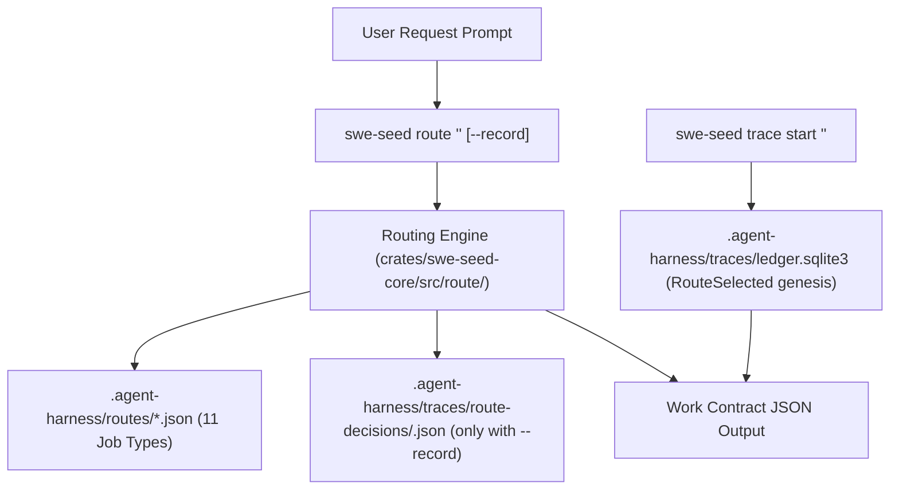
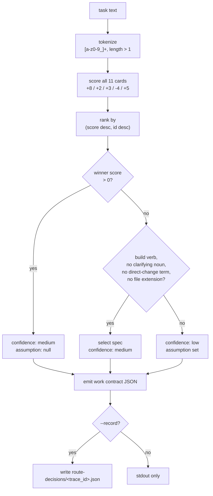
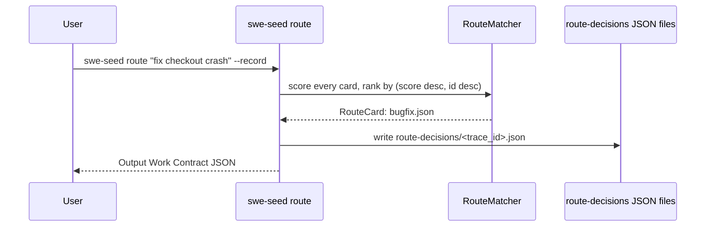

# Routing Engine Subsystem

The Routing Engine is the entry point for all task execution in SWE_SEED. It enforces the foundational operating rule: **Routing is mandatory.**

---

## 1. Purpose

The Routing Engine translates an unstructured user or agent prompt into a machine-readable, pre-declared Work Contract. By selecting a specific `RouteCard` before execution begins, it establishes bounded context, necessary skills, an ordered work loop, expected artifacts, and required proof commands, preventing agents from improvising procedures or grading their own work.

---

## 2. Responsibilities

- **Route Selection**: Matching input prompt text against the 11 canonical route cards residing in `.agent-harness/routes/`.
- **Work Contract Assembly**: Extracting required context files, skills, work stages, and proof commands for the selected job type.
- **Route Decision Recording**: Writing a standalone route-decision record when `--record` is passed.
- **Next Action Direction**: Providing concrete initial guidance to the calling agent to begin the task.

---

## 3. Non-Responsibilities

- **Does Not Modify Code**: The router produces a contract; it does not write or edit source code.
- **Does Not Execute Proof**: Proof execution is performed downstream by `just ci` or the agent.
- **Does Not Decide Merge Eligibility**: Verification of the resulting trace is performed by the Routing Gate.

---

## 4. Position in the System

- **Who calls it**: Human developers, host agents (`AGENTS.md` operating contract), `swe-seed trace start`, and orchestration hooks.
- **What it calls**: Route card loaders in `.agent-harness/routes/`, token scoring algorithms, and the secure-write helper. The router does not call the trace ledger; `swe-seed trace start` does that after routing.

---

## 5. Core Abstractions

- `RouteCard`: Struct representing a loaded `.json` route card, with fields for `id`, `job_type`, `purpose`, `semantic_triggers`, `positive_examples`, `negative_examples`, `required_context`, `required_skills`, `work_loop`, `required_artifacts`, `proof`, `done_when`, and `failure_modes`.
- `RouteDecision`: Output structure containing the selected `job_type`, `route_card` path, `required_context`, `required_skills`, `work_loop`, `required_artifacts`, `proof`, `done_when`, and `next_action`.
- `match_route(cards, prompt)`: Matching function that scores route candidates against the input prompt.

---

## 6. Internal Operation

1. **Card Discovery**: The router scans `.agent-harness/routes/` and deserializes all JSON route cards, sorted by filename.
2. **Scoring**: Every card is scored independently by `score_route()` using deterministic token overlap. The weights are fixed in `crates/swe-seed-core/src/route/mod.rs`:
   - `+8` for each `semantic_trigger` that appears as a substring of the lowercased task.
   - `+2` per shared token between the task and each `semantic_trigger`.
   - `+3` if a `positive_example` appears as a substring of the task; otherwise `+overlap` if the example shares 2 or more tokens.
   - `-4` if a `negative_example` appears as a substring; otherwise `-2 x overlap` if it shares 2 or more tokens.
   - `+5` if the task text contains the card's `job_type`.
   - Tokens are `[a-z0-9_]+` runs of length 2 or more, taken from the lowercased text.
3. **Selection Order**: Cards are ranked by score descending, then by `id` descending. The first card wins. Ties therefore resolve toward the lexicographically greatest `id`, not toward a semantic preference.
4. **Bootstrap Fallback**: If the winning score is 0 or less, the router tries `infer_bootstrap_route()`. That returns the `spec` card when the task contains a build verb (`build`, `create`, `make`, `add`, `start`, `scaffold`), contains none of `spec`/`requirements`/`contract`/`acceptance`/`criteria`/`plan`, contains none of `fix`/`debug`/`review`/`audit`/`refactor`/`release`/`document`/`docs`/`test`/`tests`/`harness`/`router`/`skill`, and has no source-file extension (`.py`, `.ts`, `.tsx`, `.js`, `.jsx`, `.md`, `.json`, `.yaml`, `.yml`, `.sh`). The fallback reports `confidence: medium` as if it scored 1.
5. **Confidence**: `medium` when the winning score is above 0, otherwise `low` with the assumption set to `No strong semantic match; selected safest default route.`
6. **Recording**: With `--record`, a route-decision JSON file is written to `.agent-harness/traces/route-decisions/`. The ledger genesis is written only by `swe-seed trace start`.

### Decision Path

**What to notice.** The tie-break on `id` is the reason two cards with identical scores resolve unpredictably from the reader's point of view: the winner is whichever id sorts last alphabetically. The bootstrap branch also reports `medium` confidence despite matching no card content, so `confidence` alone cannot tell you whether a real match occurred. Check `assumption`, which stays `null` on that path.

**Try it.** The [Routing Explorer](../cognitive/routing-explorer.html) runs this exact scoring model against the live card set and shows every card's partial score.

---

## 7. State

- **Owned State**: `.agent-harness/traces/route-decisions/<trace_id>.json` (only when `--record` is passed).
- **Read State**: `.agent-harness/routes/*.json`.
- **Modified State**: An append-only addition to `.agent-harness/traces/route-decisions/` when `--record` is passed. The router does not write to the ledger.

---

## 8. Lifecycle

---

## 9. Failure Modes

- **Misclassification**: Prompt ambiguity leads to selecting an unintended route. Resolved by providing explicit action verbs or adding negative examples to competing route cards.
- **Missing Route Card**: A required job type file is deleted from `.agent-harness/routes/`. Detected and blocked by `just harness-validate`.
- **Unrecorded Genesis**: `swe-seed route` never creates a genesis entry, with or without `--record`. A trace that must pass `swe-seed gate <id> --verify` has to be opened with `swe-seed trace start`, which routes the task and writes the genesis in one step.

---

## 10. Extension Points

- **Adding a Route Card**: Create a new JSON file in `.agent-harness/routes/<new-id>.json`. It must validate against `RouteCard` schema and satisfy `harness_validate`.
- **Tuning Matching Weights**: Adjust `semantic_triggers` and examples in existing route cards without recompiling the binary.

---

## 11. Source Trail

- `crates/swe-seed-core/src/route/mod.rs`: `RouteCard`, `RouteResult`, `score_route()`, `infer_bootstrap_route()`, `build_route_result()`, `write_route_decision()`.
- `crates/swe-seed/src/cli.rs`: Command line dispatch for `Route` subcommand.
- `.agent-harness/routes/`: Canonical JSON definitions for all 11 job types.
- `.agent-harness/baml/baml_src/harness.baml`: Canonical schema contract.
- `crates/swe-seed/tests/route_golden.rs`: Golden fixture regression tests for routing.
