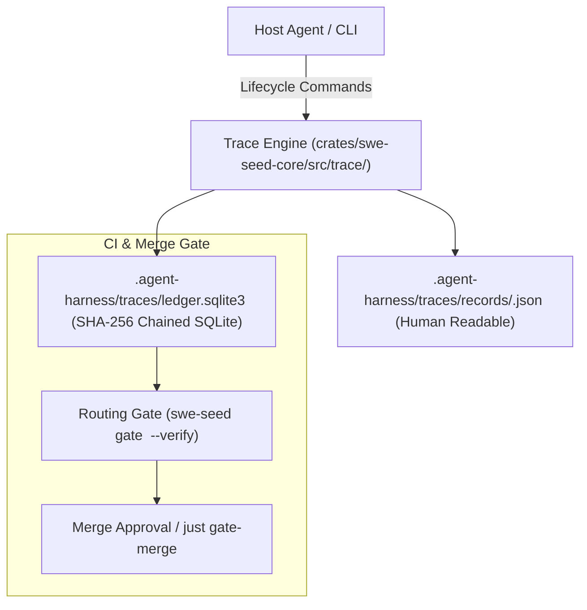
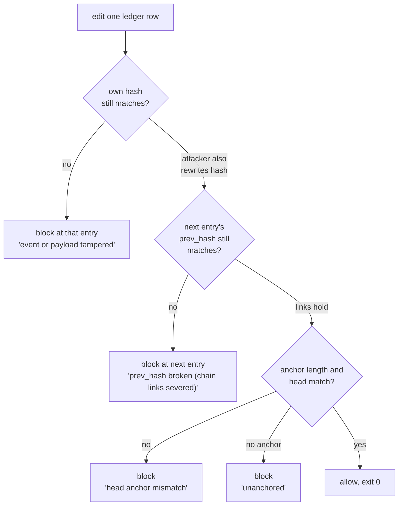
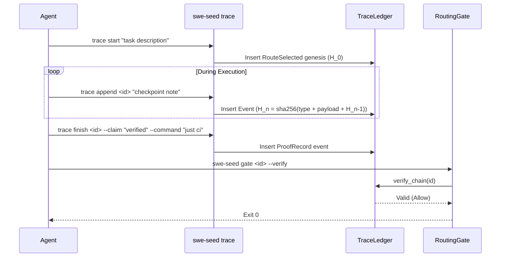

# Trace Ledger & Gate Subsystem

The Trace Ledger & Gate Subsystem provides durable, tamper-evident record keeping for all agent and developer activities, coupled with an enforcement gate that blocks unproven or unrouted changes from merging.

---

## 1. Purpose

Agent sessions are ephemeral: when a chat session terminates, the reasoning, tool calls, and completion claims vanish unless captured in structured form. The Trace Ledger records execution events into append-only JSON files and an SQLite database linked by cryptographic SHA-256 hash chains. The Routing Gate validates this chain to ensure that no code change merges without pre-bound routing and verified proof.

---

## 2. Responsibilities

- **Trace Lifecycle**: Managing the six discrete stages of execution: `start`, `append`, `checkpoint`, `resume`, `distill`, and `finish`.
- **Cryptographic Hash Chaining**: Computing and validating `sha256(event_type + "\n" + payload_json + "\n" + prev_hash)` for every recorded transition.
- **Routing Gate Enforcement**: Evaluating whether a trace originated from a valid `RouteSelected` genesis event and verifying chain integrity.
- **Durable Decisions**: Storing architectural decisions, route choices, and test outputs so successor agents can resume tasks immediately.

---

## 3. Non-Responsibilities

- **Not a Git Replacement**: Git tracks file diffs; the trace ledger tracks the rationale, routing contract, and verification claims behind those diffs.
- **Not a Cloud Telemetry Daemon**: State is kept purely in repository-local files and SQLite databases.

---

## 4. Position in the System



- **Who calls it**: `just harness-trace-*` recipes, `swe-seed trace`, `swe-seed gate`, and CI merge workflows.
- **What it calls**: `rusqlite` for database management and `sha2` for cryptographic hashing.

---

## 5. Core Abstractions

- `TraceRecord`: The serialized JSON document storing task metadata, route decisions, events, checkpoints, claims, and proof results.
- `TraceLedger`: The embedded SQLite interface maintaining the `chain_entries` table with columns `trace_id`, `seq`, `event_id`, `event_type`, `payload_json`, `prev_hash`, `hash`, and `occurred_at`, keyed by `(trace_id, seq)`.
- `RouteGate`: The evaluation enum returned by `route_gate()`:
  - `RouteGate::Allow`: Valid genesis exists and chain hashes match.
  - `RouteGate::Block(reason)`: Missing genesis, missing ledger, or hash mismatch.

---

## 6. Internal Operation

### 1. Hash Chaining

When `trace start` executes:

- An initial genesis event (`RouteSelected`) is created.
- The hash is computed over three newline-separated fields: `sha256(event_type + "\n" + payload_json + "\n" + prev_hash)`.
- The genesis entry uses `prev_hash` = 64 zeros (`GENESIS_PREV`). Each later entry uses the previous entry's `hash`.
- `payload_json` is the exact serialized payload written for that event, so any payload change breaks the chain.

### 2. Gate Verification (`swe-seed gate <id> --verify`)

- Reads all entries for `trace_id` in ascending `seq` order.
- Asserts that `seq` 0 is a `RouteSelected` event.
- For each entry, checks that `prev_hash` equals the previous entry's stored `hash`, then recomputes the entry's own hash and compares it to the stored value. The walk stops at the first failure.
- An edited payload, an inserted interior entry, or a deleted interior entry breaks one of those two checks, so the gate fails (`RouteGate::Block`) and `just gate-merge` exits 1. Deleting trailing entries does not, because the shortened prefix still verifies. See [What Tampering Is and Is Not Detected](#3-what-tampering-is-and-is-not-detected).

---

### 3. What Tampering Is and Is Not Detected

`verify_chain` walks entries in `seq` order and, for each entry, checks two things: that `prev_hash` equals the previous entry's **stored** `hash`, and that `hash` equals the recomputation from that entry's own `event_type`, `payload_json`, and `prev_hash`. It stops at the first failure.

That yields three distinct outcomes. Verified by editing a real ledger in a throwaway root:

| Edit performed                                                         | Result                   | Message                                              |
| ---------------------------------------------------------------------- | ------------------------ | ---------------------------------------------------- |
| Change only `payload_json` at `seq 1`                                  | Blocked at `seq 1`       | `entry 1: event or payload tampered (hash mismatch)` |
| Change `payload_json` at `seq 1` **and** rewrite `seq 1.hash` to match | Blocked at `seq 2`       | `entry 2: prev_hash broken (chain links severed)`    |
| Delete the final entry (`seq 2` of 3)                                  | **Not detected**, exit 0 | `allow: trace '<id>' routed + chain verifies`        |



**What to notice.** The chain detects any edit that leaves a hash inconsistent somewhere in the remaining rows. Truncation is caught by the head anchor in `ledger.anchors.json`: each append records the expected entry count and head hash, so deleting trailing entries fails with `head anchor mismatch`. A trace with no anchor (a legacy ledger, or a deleted anchor file) fails closed as `unanchored` unless `--allow-unanchored` is passed. The anchor file is Ed25519-signed with a key kept outside the ledger directory (default `$XDG_CONFIG_HOME/swe-seed/anchor-ed25519.key`, created 0600 on first use, overridable with `SWE_SEED_ANCHOR_KEY`). A writer who can edit the ledger directory but cannot read that key cannot forge an anchor, so a rewritten row or anchor fails with `signature does not verify`. A process running as the key's owner can still forge, so this is not tamper-resistance against that process. An unsigned legacy anchor file fails closed unless `--allow-unanchored` is passed. Appends refuse it, and it is never re-signed automatically: an operator signs it once with `swe-seed trace adopt-anchors` (see _Upgrading existing ledgers_). Automatic re-signing would let someone who can write the ledger directory swap in an unsigned file that matches a truncated chain and get that history signed. Appends are two-phase: the anchor's `pending` state is written before COMMIT and promoted after it, so a crash in either window self-heals on the next append. `swe-seed federation sign <trace> --key <id>` emits a signed envelope over a trace's chain root, which is the signed record that closes that gap, but it only runs for a trace with verified passing proof evidence.

## Upgrading existing ledgers

Ledgers written before anchor signing have an unsigned `ledger.anchors.json`. After upgrading, run this once per ledger, on a ledger you trust:

```bash
swe-seed trace adopt-anchors
```

It checks that every anchored chain matches its committed anchor. If any chain does not match, it refuses and signs nothing. Otherwise it signs the file and prints the adopted traces. A signed file is refused with `already signed`. Until adoption, appends fail with `unsigned (legacy)`, and `gate --verify` fails the same way unless `--allow-unanchored` is passed.

Adoption is trust-on-first-use. It trusts the chains as they are at the moment you run it. Run it before any untrusted write can reach the ledger directory.

**Try it.** The [Trace Chain Explorer](../cognitive/trace-chain-explorer.html) replays a real four-entry chain and lets you apply the first two edits to see which entry the gate names.

---

## 7. State

- **Owned State**:
  - `.agent-harness/traces/records/<trace_id>.json`: Canonical JSON trace records.
  - `.agent-harness/traces/ledger.sqlite3`: Cryptographic ledger database.
  - `.agent-harness/traces/route-decisions/<trace_id>.json`: Standalone route decision records.
- **Read State**: None (self-contained).
- **Modified State**: Appends records during task execution.

---

## 8. Lifecycle



---

## 9. Failure Modes

- **Chain Tampering**: Manual edits to `records/<id>.json` or `ledger.sqlite3` invalidate the hash chain, causing `swe-seed gate` to fail closed.
- **Missing Genesis**: Creating a trace without selecting a route results in a `Block` status because routing is mandatory.
- **Unclosed Trace**: Attempting to gate a trace that has not received a `trace finish` command will be rejected for missing proof claims.

---

## 10. Extension Points

- **Custom Event Payloads**: Extend `TraceSchema` in `crates/swe-seed-core/src/trace/schema.rs` to support new structured event types.
- **Custom Gate Conditions**: Add additional verification rules to `crates/swe-seed-core/src/routing_gate.rs`.

---

## 11. Source Trail

- `crates/swe-seed-core/src/trace/lifecycle.rs`: Lifecycle implementations (`start`, `append`, `checkpoint`, `resume`, `distill`, `finish`).
- `crates/swe-seed-core/src/trace/record.rs`: `TraceRecord` struct and JSON serialization.
- `crates/swe-seed-core/src/trace_ledger.rs`: SQLite ledger, hash chaining, and `verify_chain()`.
- `crates/swe-seed-core/src/routing_gate.rs`: `route_gate()` logic.
- `crates/swe-seed/src/trace_cli.rs`: CLI command handlers.
- `crates/swe-seed/src/gate_cli.rs`: Gate CLI command handler.
- `docs/specs/0014-trace-and-durable-decisions.md`: Specification.
